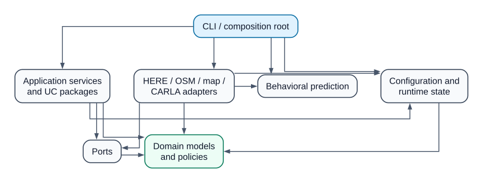
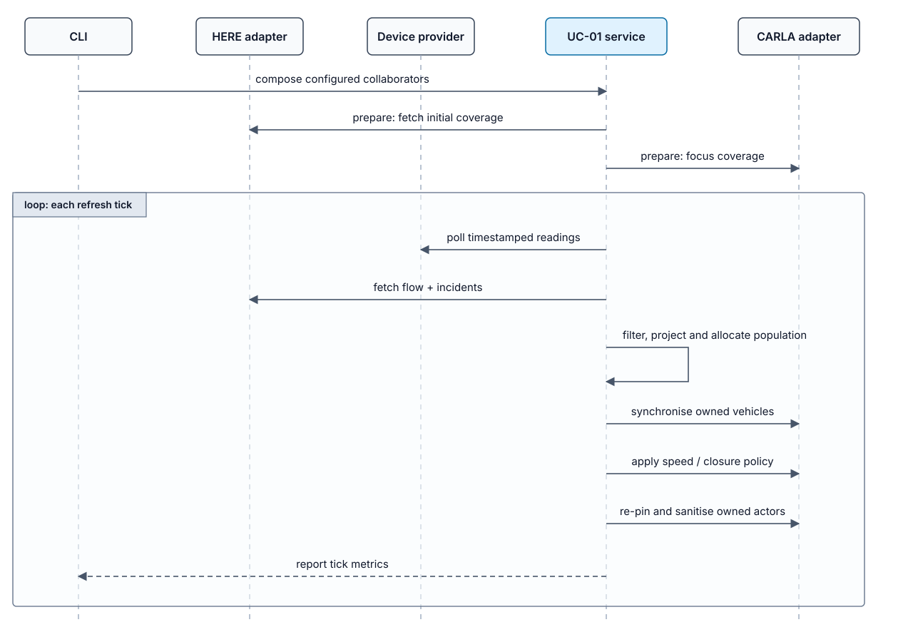
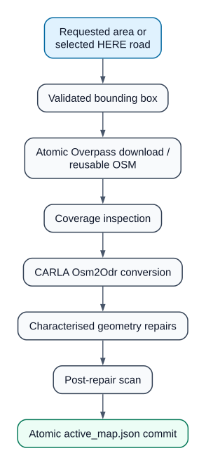
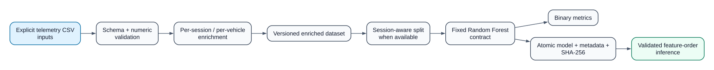

# MOTION architecture

## Dependency boundaries

MOTION is organised as a Python package with a single composition root.
The CLI builds the concrete HERE, OSM and CARLA adapters and passes them to
application services. UC packages contain orchestration or traceability
metadata; they do not contain private copies of external clients. Domain rules
remain importable without CARLA, Requests or the scientific stack.

These arrows represent imports between top-level package areas. Prediction has
its own schema and training contracts; it does not import `motion.domain`, which
currently contains UC-01's simulator-neutral traffic policies. The domain
performs no I/O and does not import CARLA, Requests, pandas or scikit-learn.
Dedicated UC packages do not import one another; UC-02 and UC-03 instead both
import the shared `motion.application.scenario_workflow` and
`motion.domain.kpi`/`motion.domain.heatmap` modules, the same pattern UC-01
already uses for `map_provisioning.py` and `road_selection.py`.

## Package responsibilities

| Package | Responsibility |
|---|---|
| `motion.domain` | Geographic value objects, map and traffic contracts, device semantics, population and speed policies, scenario modification metadata (`scenarios.py`), KPI math (`kpi.py`) and congestion-heatmap assembly (`heatmap.py`). |
| `motion.ports` | Protocols for traffic acquisition, field observations, simulation (including `TrafficSimulator.average_speed_kmh`) and local map processing. |
| `motion.application` | Map provisioning, HERE-road selection, live/offline traffic-provider selection (`traffic_providers.py`) and the shared UC-02/UC-03 propose/stage/apply workflow (`scenario_workflow.py`). |
| `motion.application.use_cases` | One package per documented Macro UC; UC-01, UC-02 and UC-03 own executable orchestration, UC-04–UC-07 expose traceability metadata only. |
| `motion.infrastructure.here` | Credential-safe HTTP acquisition, parsing, incident enrichment and verifiable optional archival. |
| `motion.infrastructure.osm` | Overpass download with explicit timeout, contact metadata and atomic destination replacement. |
| `motion.infrastructure.maps` | OSM inspection, projection, Osm2Odr conversion and characterised OpenDRIVE repair tools. |
| `motion.infrastructure.carla` | Lazy CARLA loading, server/client lifecycle, map loading, actor ownership, population, TrafficManager commands, sanitisation, calibration and measured average speed. |
| `motion.infrastructure.reporting` | Rendering adapters for generated report artifacts; currently the UC-03 congestion-heatmap image (lazy, optional `viz`/matplotlib extra). |
| `motion.prediction` | Versioned feature schema, telemetry enrichment, split/training/evaluation, model persistence and inference tracking for the existing behavioral experiment. |
| `motion.config` | Static settings, project-root discovery/override, versioned active-map state and versioned scenario state (`scenario_state.py`). |
| `motion.cli` | Argument parsing, composition and user output; no domain rules. |

UC-01, UC-02 and UC-03 are the executable macro use cases. The package/status
mapping and the evidence for UC-04–UC-07 are recorded in
[use-cases.md](use-cases.md).

## UC-01 data flow

The initial coverage preparation intentionally performs a HERE fetch before the
first tick because that was observable in the original workflow.  A failed flow
refresh falls back to device-derived uniform population while the root cause is
logged.  The update interval remains 60 seconds by default and the watchdog runs
between refreshes.

The CARLA adapter owns an explicit actor registry.  Cleanup and defect rules may
destroy only registered actors; unrelated ScenarioRunner or user vehicles are
not touched.  Expensive map generation happens once during provisioning and the
mirror loads the registered OpenDRIVE file instead of rebuilding it per check.

## Map and geospatial flow

The active-map record is committed only after conversion and repair complete.
Map names are constrained before becoming paths.  Coordinates use the numerical
conventions of the original implementation; these are local approximations, not
claims of survey-grade geodesy.

## Scenario simulation flow (UC-02/UC-03)

UC-02 and UC-03 both follow `stage -> (external edit) -> apply -> simulate`:

1. **`stage`** reuses `application.road_selection` and the unmodified
   `MapProvisioningService` to propose a road and provision its map exactly
   as `motion map mirror-road` does; the baseline map therefore legitimately
   becomes the active map (`var/runtime/active_map.json`). A copy of the
   baseline `.osm` is staged as a sibling named map
   (`data/maps/<baseline>__scenario-<id>/...`) for external editing (e.g.
   JOSM); MOTION never edits map geometry itself.
2. **`apply`** converts and repairs the *edited* OSM into OpenDRIVE using the
   same `MapConverter`/`MapArtifactProcessor` ports UC-01 provisioning uses,
   but never commits to `active_map.json` -- the modified variant is tracked
   only by its own `ScenarioRecord` (`var/runtime/scenarios/<id>.json`,
   `config.scenario_state`), a parallel, equally schema-versioned and
   atomically-written pointer file. `apply` refuses to proceed if the
   editable file's SHA-256 still matches its staged-time value ("no edit
   detected").
3. **`simulate`** fetches real HERE segments once (live, or offline via the
   same synthetic provider `motion mirror --offline` uses) and freezes them
   (`FrozenTrafficProvider`) so the baseline KPI computation and the
   modified-map simulation react to identical traffic. It then builds a
   *second* `CarlaTrafficSimulator` pointed at the modified OpenDRIVE and
   drives it with UC-01's own, unmodified `TrafficMirrorService` for the
   requested tick count. KPIs are read from the simulator immediately after
   the ticks complete and before it closes.

Every step reuses UC-01's existing ports and services; only the "never touch
`active_map.json` for the variant" rule and the KPI/heatmap math
(`domain.kpi`, `domain.heatmap`) are new. Full KPI methodology and its
documented approximations are in [scenario-kpis.md](scenario-kpis.md); the
exact CLI commands and generated file layout are in each package's own
README (`src/motion/application/use_cases/uc02_what_if_scenario/README.md`,
`.../uc03_infrastructure_event_simulation/README.md`); UC-01's own flow is
documented the same way in
`src/motion/application/use_cases/uc01_real_time_traffic_mirroring/README.md`.

## Configuration and state

Static settings are loaded from the local `.env`, then overridden by process
environment variables. Secrets remain local. The generated map bounding box, paths, device
registry and selection filters are persisted atomically in
`var/runtime/active_map.json` with a schema version.  A read-only migration path
understands the former environment variables, but application code never writes
runtime state back into `.env`. Each UC-02/UC-03 scenario has its own parallel,
equally atomic and schema-versioned pointer file at
`var/runtime/scenarios/<scenario-id>.json` (`config.scenario_state`), which
embeds a full copy of its baseline `ActiveMapState` so a scenario remains
reconstructable even after an unrelated `motion mirror` run replaces the
single current active map.

## Behavioral ML flow

The collector and prediction schema both include `weather_rain`.  Future labels
are calculated within the same session and vehicle, eliminating the original
cross-vehicle shift.  When a session identifier exists, the train/test split is
grouped by session; row-level fallback is retained only for legacy data without
session metadata and is reported as such.  This pipeline predicts a per-vehicle
behavioral incident label and is not an implementation of UC-04.

## External boundaries and optional dependencies

- HERE and Overpass require network access; HERE additionally requires a local
  API key.  Ordinary tests use sanitised fixtures and fake transports.
- CARLA is installed separately. The external `carla` module is loaded only
  when a live adapter is constructed or a CARLA command is executed, so package
  import and offline tests do not require it.
- pandas, scikit-learn, NumPy and joblib are in the `ml` extra.
- matplotlib is in the `viz` extra, required only for UC-03's congestion-heatmap
  image rendering (`infrastructure.reporting.heatmap`); it is imported lazily,
  so core package import and UC-02's own workflow never require it.
- Model files use pickle/joblib semantics.  A checksum detects corruption but
  is not a signature; only trusted artifacts may be loaded.

The retained numerical behaviors and deliberate corrections are listed in the
[non-regression matrix](non-regression.md). In particular, the CARLA adapter
tracks actor ownership so cleanup cannot remove unrelated world actors.
